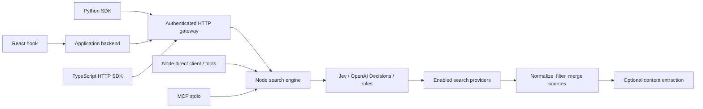

# Architecture

Last updated: 2026-10-19

The Node core owns provider protocols, routing, normalization and content extraction. The HTTP service adds access policy, gateway keys and per-process limits. TypeScript and Python HTTP SDKs consume the same JSON contract. React calls an application's authenticated backend through the HTTP client. Agent tools call either the in-process core or an HTTP SDK.

## Execution

1. Validate the request and merge defaults. Determine credentials locally or per call. Intersect server enablement, gateway-key scope and caller selection.
2. Resolve routing. Explicit modes avoid decision-provider calls. Auto mode honors application overrides, then tries Jev, OpenAI Decisions and capability rules. Decisions only select known candidates and never carry credentials or arbitrary URLs.
3. Dispatch with a shared deadline and caller signal. Parallel mode waits for each bounded attempt, returning partial successes. Fallback runs sequentially. There are no automatic same-provider retries.
4. Normalize URLs, distinguish snippets/answers/text, apply domain policies, and merge with reciprocal-rank fusion. Upstream titles, dates and text remain provider assertions, not independently verified facts.
5. If requested, use an enabled authorized extractor to fill missing text. Apply character limits and return warnings for unavailable content.

The main TypeScript export uses Web Fetch APIs only and has no Node imports. `/core` and `/server` contain Node capabilities and secret handling. `/react` is optional. Python is a dependency-free HTTP SDK with typed transport records and a worker-thread async facade. There is one provider engine, rather than duplicated vendor behavior across languages.

## Credentials and operation

Gateway keys are opaque random bearer values. Local provisioning stores SHA-256 hashes and metadata in an atomic file protected by an exclusive writer lock. Revocation is read on every authenticated request. This is a single-process deployment model, not a managed account/billing platform. A gateway operator can replace authentication with a shared database implementation.

Provider URLs are fixed in adapter code. Per-call credentials remain in request memory and are never persisted by the gateway. No provider responses or query bodies are logged or cached. Vendor policies still govern traffic sent upstream. Extractors fetch target URLs in the vendor's environment; this project does not run a web crawler.

Transport and routing timeouts bound waiting, not external billing or cancellation guarantees. An upstream job may continue after the local deadline, especially Happenstance async searches. Raw provider options may change costs. Key scopes, provider caps and rate limits help bound use, but do not implement a currency budget.

## Extending

Add a provider by updating the TypeScript `ProviderId` union, Python mirror, registry, key environment map, primary-source capability documentation and contract fixtures together. Built-in IDs can be replaced with trusted custom adapters. A custom router can use application cost/latency/relevance signals and must return a subset of supplied candidates. Decisions and rules never bypass provider enablement or gateway scopes.

The release includes source tests and installable artifacts. Mock contract tests establish our outbound shape and normalization behavior. Live provider access and routing quality are separate proofs, intentionally deferred until credentials are supplied.
